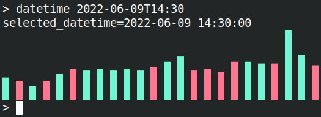

# Volume Companion

<!-- Badges -->
[](https://github.com/rlacher/volume-companion/actions/workflows/flake8.yaml)
[](https://github.com/rlacher/volume-companion/actions/workflows/mypy.yaml)
[](https://github.com/rlacher/volume-companion/actions/workflows/pytest.yaml)
[](https://spdx.org/licenses/MIT.html)

Command-line tool displaying historical trading volume as ASCII bars from local CSV data.

## Table of Contents

- [Features](#features)
- [Installation](#installation)
- [CSV Input](#csv-input)
- [Usage](#usage)
- [Example](#example)
- [Commands](#commands)
- [Testing](#testing)
- [License](#license)
- [Author](#author)

## Features

- Offline processing of OHLCV CSV data.
- Fast in-memory queries with immediate response.
- ASCII-art volume bars with colour coding.
- Optional verbose output showing numeric OHLC and volume.
- Prompt-based interface with session state.
- Handles invalid input gracefully without exiting.
<!-- - Supports higher-timeframe aggregation with incomplete bar marking. -->

## Installation

Clone the repository, then install dependencies with:

```bash
poetry install
```

## CSV Input

The CSV holds one bar per row, without a header, in the fixed column order `YYYY.MM.DD,HH:MM,open,high,low,close,volume`:

```csv
2025.12.19,13:00,1.1390,1.1400,1.1385,1.1395,12345
```

Timestamps mark each candle's opening time, not its closing time. A candle is only displayed once it has fully closed. The timeframe is inferred from the smallest interval between consecutive rows, so the bar opening at the selected datetime is never included.

## Usage

Run the project using:

```bash
poetry run volume-companion path/to/data.csv
```

After startup, the tool enters an interactive prompt.
Type `help` to list available commands.

## Example



Each column is one bar, oldest on the left. Bar heights are scaled to the largest volume in the current window; green bars have a closing price at or above their opening price, red bars below.

## Commands

Within the prompt you can configure the session, navigate through data, and display volume at specific points in time.

- `datetime [<YYYY-MM-DDTHH:MM>]`: Display bars completed at or before the selected datetime or jump to the provided datetime (ISO format)
- `bars <number>`: Set the number of displayed bars
- `offset <hours>`: Set the time zone offset
- `step [<number>]`: Advance one or multiple bars (number optional, defaults to 1)
- `verbose`: Toggle verbose output
- `config`: Show current session configuration (bars, offset, verbose mode)

## Testing

Install the development dependencies and run the test suite locally with:

```bash
poetry install --with dev
poetry run pytest --cov=src/ --cov-branch tests/
```

## License

This project is licensed under the [MIT License](LICENSE).

## Author

Developed by [René Lacher](https://github.com/rlacher).

